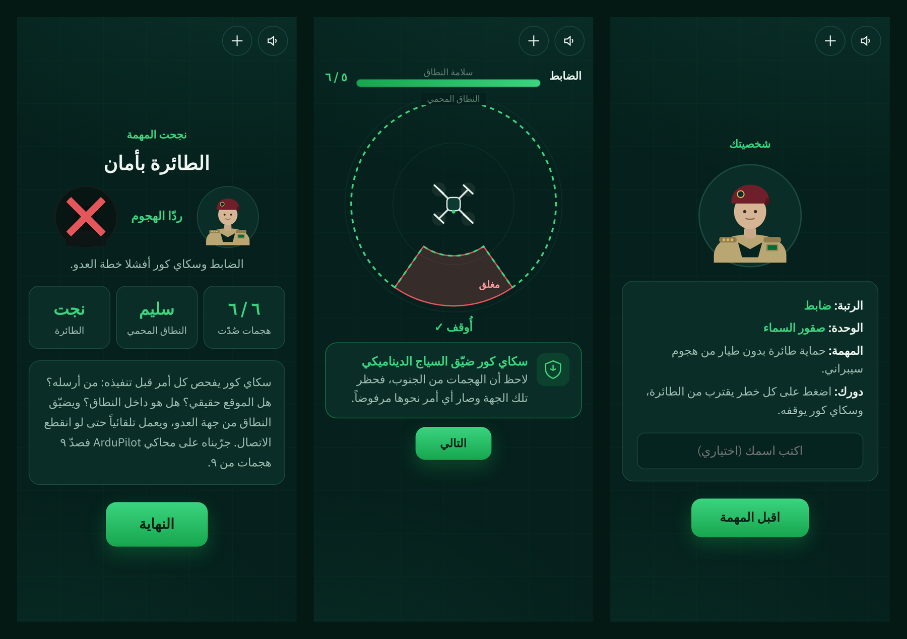

# سكاي كور سيميوليشن | SKYCORE Simulation

تجربة تفاعلية لمشروع **سكاي كور** في هاكاثون سيف. تلعب دور ضابط يحمي طائرة بدون طيار من عدو يحاول السيطرة عليها بهجمات سيبرانية، وسكاي كور يوقف كل هجوم.

**جرّب التجربة:** [reefmansour66.github.io/skycore-simulation](https://reefmansour66.github.io/skycore-simulation/)

## طريقة اللعب

1. اقبل المهمة.
2. اضغط على كل خطر يقترب من الطائرة. إذا تأخرت، يوقفه سكاي كور تلقائياً.
3. في الهجوم الأخير اضغط على العدو لتفعّل الوضع الآمن.

تعمل التجربة على الجوال والكمبيوتر، ولا تحتاج تثبيت: افتح `index.html` في أي متصفح.

## ماذا يفعل سكاي كور؟

سكاي كور طبقة حماية بين محطة التحكم الأرضية والطيار الآلي، تفحص كل أمر قبل تنفيذه:

- **من أرسله؟** يتحقق من توقيع المشغّل الحقيقي ورقم الأمر.
- **هل الموقع حقيقي؟** يقارن إشارة GPS بحسّاسات الحركة.
- **هل هو داخل النطاق؟** يمنع الطائرة من الخروج من النطاق المحمي.
- **السياج الديناميكي:** إذا تكررت الهجمات من جهة، يغلقها.
- **الوضع الآمن:** ينقل الطائرة إلى نقطة آمنة بعيداً عن العدو، ويعمل حتى لو انقطع الاتصال.

جرّبنا سكاي كور على محاكي ArduPilot فصدّ ٩ هجمات من ٩.

## الهجمات في التجربة

| الهجوم | ماذا يفعل العدو | كيف يصدّه سكاي كور |
| --- | --- | --- |
| تزييف الموقع | يرسل إشارة GPS مزيّفة | حسّاسات الحركة تكشف أن الطائرة لم تتحرك |
| أمر مزيّف | يرسل أمراً بلا توقيع | يحظر أي أمر لا يحمل توقيع المشغّل |
| أمر مكرّر | يعيد إرسال أمر قديم | يحظر الأمر لأن رقمه قديم |
| خارج النطاق | يوجّه الطائرة لمنطقة خطرة | يمنعها من الخروج من النطاق المحمي |
| سحب نحو العدو | يكرر الهجوم من جهة واحدة | يغلق تلك الجهة بالسياج الديناميكي |
| الكمين | يقطع الاتصال وينتظر الطائرة في طريق العودة | يفعّل الوضع الآمن وينقلها بعيداً عنه |

## English

SKYCORE is a cyber-physical integrity layer for UAVs. It sits between the ground radio and the autopilot and checks who sent each command (operator signature and sequence number), whether the GPS position agrees with the motion sensors, and whether the command stays inside the mission bounds. It also closes the side of the geofence that attacks come from, and flies to a safe point away from the attacker if the link is cut. In an ArduPilot SITL test it blocked 9 of 9 attacks.

This repository is an interactive Arabic web demo built for the Saif Hackathon. It is a single `index.html` file with no build step. Live demo: https://reefmansour66.github.io/skycore-simulation/

## الفريق

- [ريف العتيبي](https://www.linkedin.com/in/reef-alotaibi-568780175)
- [جوري الحمود](https://www.linkedin.com/in/jory-alhamoud-544499235)
- [سارة المقبل](https://www.linkedin.com/in/sarahalmuqbil)
